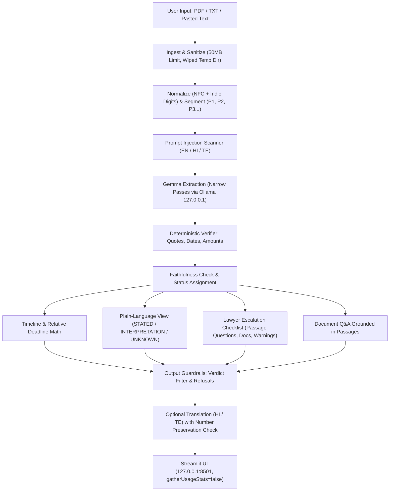

# NoticeGuard Architecture & System Design

NoticeGuard is a local-first legal triage assistant built for PS2 (Private Legal Document Triage Agent). It is specifically designed for students, freelancers, and tenants in India receiving payment demands, eviction notices, and legal notices.

## Core Principle: Gemma Explains, Code Verifies

```
Gemma handles:        Code verifies:
----------------      ----------------
• Summarization       • Exact & fuzzy quote check (NFC normalized)
• Plain-language      • Date math & statutory deadline calculation
• Multi-turn Q&A      • Number & currency verification
• Translation         • Prompt injection attack scanning
                      • Legal verdict & enforceability filter
```

Anything code cannot deterministically verify is marked `UNVERIFIED` or dropped.

---

## Architecture Flow Diagram



---

## Module Breakdown

| Module | Responsibility | Safety / Verification Rule |
| :--- | :--- | :--- |
| `ingest.py` | Loads PDF/TXT, extracts text with PyMuPDF, rejects corrupt/binary files. | Zero logging of document contents. Temporary files wiped on demand. |
| `segment.py` | NFC normalization, Indic numerals (Devanagari ०-९, Telugu ౦-౯) to ASCII, passage segmentation into $P_1, P_2, \dots$. | Normalization runs before any verification or regex check. |
| `guardrails.py` | Scans for prompt injection attacks, detects verdict/enforceability traps, sanitizes outputs. | Queries like "Is this legal?" or "Should I pay?" are refused 100% of the time. |
| `extract.py` | Communicates with local Gemma via Ollama on `127.0.0.1:11434` with strict schema and 1 retry. | Fallback deterministic regex extractor if Ollama is unavailable. |
| `verify.py` | Verifies that quotes exist in source text (exact NFC or fuzzy ratio $\ge 88\%$). Verifies numbers/amounts. | Marks unquoted claims as `UNVERIFIED` or `UNKNOWN`. |
| `timeline.py` | Calculates calendar deadlines from relative durations (e.g. "within 15 days of receipt") using prompt receipt date. | Flags vague phrases ("immediately", "forthwith") as `AMBIGUOUS`. |
| `explain.py` | Paraphrases complex legal clauses calmly. | Tags every item as `STATED`, `INTERPRETATION`, or `UNKNOWN`. Quotes remain untranslated. |
| `missing_clauses.py` | Scans for silent/missing protections (cure periods, arbitration, itemized proof of debt, remittance coordinates). | Explicitly alerts recipient to omitted contractual protections. |
| `escalate.py` | Builds actionable lawyer preparation brief. | Generates passage-specific questions, evidence checklist, and jurisdiction warnings. |
| `translate.py` | Translates verified explanations into Hindi or Telugu. | Quotes are never translated. Preserves numbers and appends machine translation disclaimer. |
| `app.py` | Local Streamlit web dashboard. | Binds strictly to `127.0.0.1:8501`. Complete session wipe button. |

---

## Privacy Threat Model & Boundary Guarantees

1. **Zero Outbound Telemetry**: Streamlit's `gatherUsageStats` is hardcoded to `false`.
2. **Local Loopback Only**: All LLM inference connects strictly to Ollama via `127.0.0.1:11434`.
3. **Session Ephemerality**: In-memory state and temporary files are wiped upon clicking "Wipe Session".
4. **Offline Resilience**: NoticeGuard functions deterministically without any internet connection.
